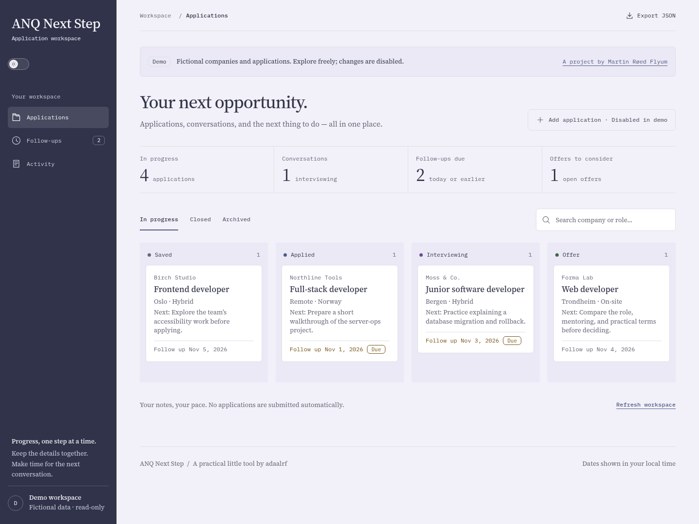

# ANQ Next Step

[](https://github.com/adaalrf/anq-next-step/actions/workflows/check.yml)

A job-application workspace for keeping a role, its cover letter and the next
follow-up together. Forms retain entered text after failed saves, and conflicting
edits surface for review. Built with React, TypeScript, Fastify and PostgreSQL.

[Explore the read-only demo](https://tracker.demo.adaalrf.dev) · [Case study](https://adaalrf.dev/work/anq-next-step/) · [Source map](CONTRIBUTING.md#where-changes-belong)

The demo contains fictional applications. The owner workspace uses a separate database.



## Review path

- [RecordDialog](src/client/components/RecordDialog.tsx) handles application materials, validation and unsaved changes.
- [Shared model](src/shared/model.ts) defines stages and calendar-date follow-up rules.
- [Browser workflows](tests/browser.ts) follow an application through saving, stage changes, notes and follow-ups.

## How this project is developed

The maintainer decides the workflow and interface direction. AI coding agents
write and revise implementation code. The [development guide](CONTRIBUTING.md)
sets the data and verification boundaries. Changes to saved materials, history and
conflict handling are checked against disposable PostgreSQL and browser workflows.

The [initial public release](https://github.com/adaalrf/anq-next-step/commit/3abb4a5) is a squashed snapshot of pre-publication development; subsequent changes are recorded incrementally.

## Run locally

Requires Linux, Node.js 24+, npm and rootless Podman:

```sh
npm ci
npm run setup:local
npm run dev
```

Open http://localhost:5174. Read your generated owner password privately in
`.local/owner-credentials.json`. Setup creates a PostgreSQL 17 workspace with
fictional records. Repeating it preserves data and credentials; Ctrl-C stops the
API and Vite while the database volume persists. Keep local credentials out of Git.

## Workflow

- Save roles, listing URLs, application addresses, contacts and salary/terms.
- Prepare a plain-text cover letter and next action before applying.
- Track stages from Saved through Applied, Interview and Offer to a closed outcome.
- Record follow-ups and schedule the next date in one save.
- Keep conversation notes and stage changes in the activity history.
- Archive without losing history; export all records and history as JSON.

Stale edits produce a conflict rather than overwriting newer changes. Unsaved-form
warnings do not store drafts. Dates remain calendar dates across timezones.

## Real application workflow

1. Add the company and role; save the listing URL and an email/postal application
   address when needed. Keep it in Saved while preparing.
2. Paste your cover letter, record the next action, and save. You can reopen and
   edit the saved text; the letter is included in export and database backups.
3. Submit to the employer outside Next Step. Set the stage to Applied and record
   the submission date and a follow-up date.
4. Record follow-ups to save what happened, update the next action, and schedule
   the next date (or clear it to finish that follow-up). Update status as it moves
   through interviews, offers, or closure. Archive retains the record and history.

Cover letters are stored as plain text; this release does not upload documents
or submit applications automatically. Daily backups protect saved records, not
unsaved form drafts. See [deployment](docs/DEPLOYMENT.md) for recovery and backup retention.

## Configuration and limits

`.env.example` describes manual configuration; [deployment](docs/DEPLOYMENT.md)
covers owner mode and the read-only demo.

This is a personal workspace: no collaboration, delivered reminders, document
uploads or automatic applications. Lists are unpaginated. The UI shows the latest
500 history entries per application/activity view; export includes all history.
There is no JSON import endpoint. History is append-only through the API, not
protected against database administrators.

## Development and deployment

[Contributing](CONTRIBUTING.md) covers source layout, daily commands and isolated
API/browser tests. [Architecture](docs/ARCHITECTURE.md) explains the data and
authorization boundaries. [Deployment](docs/DEPLOYMENT.md) covers hosting, durable
storage, backups and recovery. Never point tests or demo seeding at a production database.

For a read-only sample prepared on a known UTC date, set `DEMO_DATE_ANCHOR=YYYY-MM-DD` alongside `DEMO_MODE=true`. API dates then move together relative to today; stored records, text and pagination keys remain unchanged. Leave it blank for stored dates. Owner mode rejects this setting. The demo banner explains the relative dates.
